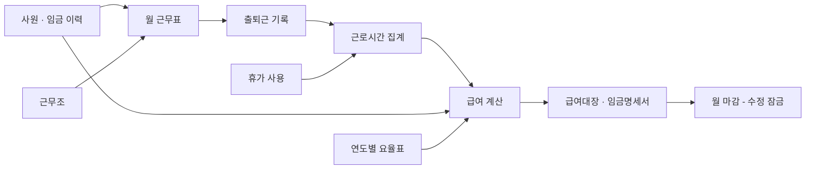

# P3 제조업 HR 미니 ERP — 기획서 v0.1 (뼈대)

> ✅ 핵심 결론
> → 회계·생산·재고는 빼고 **인사·근태·급여 3개 모듈**만, 가상 중소 제조사(40명, 주야 2교대) 기준으로 **4주 안에** 만든다.
> → 코드는 Claude가 쓰고, 태식은 **법 조항을 계산 규칙으로 바꾸는 일과 손계산 검증**을 맡는다. 면접에서 내세울 건 코드가 아니라 이 부분이다.
> → 용어와 처리 순서는 ERP정보관리사 시험 프로그램(더존)에 맞추고, 화면 디자인은 따라 하지 않는다 (§6-2). 시험 공부와 개발이 서로 복습이 되게 하기 위해서다.
> → 이번 주 할 일: ① 인사담당자 2명 인터뷰 ② 이 문서 승인

- 용도: 본인용 (개발 기준서 + 면접 때 구조 설명용)
- 이 문서는 **v0.1 뼈대**다. 범위·데이터 구조·화면·규칙 목록만 정했고, 계산식 상세는 인터뷰를 반영해 v0.2에서 채운다.

---

## 1. 목표와 성공 기준

**목표:** "ERP를 써 봤다"(자격증)와 "ERP가 어떻게 돌아가는지 안다"(직접 설계)를 한 번에 증명한다.

| # | 성공 기준 | 측정 방법 |
|---|---|---|
| 1 | 손계산 검증 케이스 10건이 시스템 결과와 전부 일치 | 엑셀 손계산 vs 시스템 금액 비교 (원 단위) |
| 2 | 현업 인사담당자 2명 이상 인터뷰 반영 | 인터뷰 기록지 2부 + 설계 반영 항목 수 |
| 3 | 11/22까지 배포 URL 확보 | Streamlit Cloud 주소 |
| 4 | 더존 메뉴 대응표 완성 | §6 마지막 칸, ★ 화면 11개 전부 채움 |

---

## 2. 4주 로드맵

| 주차 | 기간 | 개발 (Claude와 함께) | 태식 단독 |
|---|---|---|---|
| 1주 | 10/26 ~ 11/1 | 프로젝트 뼈대, 샘플 데이터 생성 | 인터뷰 2명, 이 문서 확정, 법령 원문 대조 |
| 2주 | 11/2 ~ 11/8 | 기준정보·인사·근태 화면 (S01~S09) | 손계산 검증 케이스 10건 작성 |
| 3주 | 11/9 ~ 11/15 | 연차·급여·명세서 (S10~S13) | 검증 케이스 대조, 오류 기록 |
| 4주 | 11/16 ~ 11/22 | 대시보드, 배포, 포트폴리오 P3 페이지 | README의 "법 조항 → 로직" 표 정리 |
| (참고) | 11/28 (토) | — | ERP정보관리사 시험 (자격증 준비는 태식이 별도로) |

👉 HR 인사이트: 시험 공부(더존으로 인사·급여 처리)와 개발이 같은 4주에 겹치는 게 장점이다. 더존 화면에서 본 메뉴를 내 시스템의 어느 화면에 대응시킬지 비교하면서 공부하면, 둘 다 빨리 는다. §6 화면 목록의 마지막 칸이 그 용도다.

---

## 3. 가상 회사 설정

| 항목 | 값 | 이렇게 정한 이유 |
|---|---|---|
| 회사 | (가상) 다온정밀 — 자동차 부품 가공 | 중소 제조업의 전형 |
| 인원 | 40명 (생산직 30, 사무직 10) | 5인 이상 → 근로기준법 전면 적용 |
| 생산직 | 시급제, 주간조·야간조 2교대, 주 단위 교대 | 연장·야간 가산이 매달 발생 |
| 사무직 | 월급제, 09~18시 | 월급 → 통상시급 환산 규칙 필요 |
| 연차 기준 | 입사일 기준 (인터뷰 후 확정) | 회계연도 기준을 쓰는 회사도 많음 |

- 샘플 데이터는 Claude가 생성한다. 실제 회사·실제 직원 정보는 쓰지 않는다.

---

## 4. 범위

| 만든다 (MVP) | 안 만든다 (이번에는) |
|---|---|
| 인사 정보, 발령·임금 이력 | 회계 전표 연동 |
| 근무표, 출퇴근 기록, 근로시간 집계 | 4대보험 취득·상실 신고 |
| 연차 발생·사용·승인 | 연말정산 |
| 급여 계산, 급여대장, 월 마감, 임금명세서 | 퇴직금 정산 (여유 있으면 추가) |
| 간단한 인사 대시보드 | 채용·평가·교육 |

---

## 5. 데이터 구조

### 5-1. 데이터 흐름

### 5-2. 테이블 목록 (17개)

뼈대를 만들면서 공휴일 달력(`holiday`)을 하나 더했다. 같은 근무라도 그날이 공휴일인지 알아야 휴일근로(R3)를 가를 수 있기 때문이다.

| 묶음 | 테이블 | 이름 | 핵심 칸 | 왜 필요한가 |
|---|---|---|---|---|
| 기준정보 | `company` | 회사 설정 | 상시근로자 수, 급여 지급일, 연차 기준 | 5인 미만 여부·연차 기준에 따라 규칙이 갈린다 |
| | `rate_table` | 연도별 요율표 | 연도, 최저시급, 4대보험 요율 | 매년 바뀌는 값을 코드에 박지 않는다 |
| | `holiday` | 공휴일 달력 | 날짜, 이름 | 공휴일 근무는 휴일근로가 된다 |
| | `code` | 공통코드 | 그룹(직급·고용형태·휴가 종류), 코드, 이름 | 선택지를 한곳에서 관리 |
| | `department` | 부서 | 부서코드, 부서명, 상위 부서 | 조직도 |
| | `shift` | 근무조 | 조 이름, 시작·종료 시각, 휴게시간 | 주간조·야간조 정의 |
| | `pay_item` | 급여항목 | 항목명, 지급/공제, 과세 여부, 통상임금 포함 여부 | 통상임금 판단이 모든 가산수당의 출발점 |
| 인사 | `employee` | 사원 (인사카드) | 사번, 이름, 부서, 직급, 고용형태, 급여형태(월급/시급), 입사일, 퇴사일 | 모든 데이터의 기준 |
| | `assignment` | 발령 이력 | 사번, 발령일, 종류(입사·승진·전보·퇴사), 변경 전/후 | 덮어쓰지 않고 이력으로 쌓는다 |
| | `wage_contract` | 임금 이력 | 사번, 적용 시작일, 기본급 또는 시급, 고정수당 | 임금이 바뀐 달도 정확히 계산 |
| 근태 | `schedule` | 근무표 | 사번, 날짜, 근무조, 날짜 구분(소정근로일·주휴일·휴무일·공휴일) | 같은 8시간도 날짜 구분에 따라 수당이 다르다 |
| | `attendance` | 출퇴근 기록 | 사번, 날짜, 출근·퇴근 시각 | 원본 기록 |
| | `work_summary` | 근로시간 집계 | 사번, 날짜, 소정·연장·야간·휴일 시간 | 계산 결과를 남겨 급여와 대조 |
| | `leave_grant` | 연차 발생 | 사번, 발생일, 일수, 근거 | 왜 그만큼 생겼는지 남긴다 |
| | `leave_use` | 휴가 사용 | 사번, 날짜, 종류, 일수, 상태(신청·승인·반려) | 승인 흐름 |
| 급여 | `payroll_run` | 급여 회차 | 귀속 연월, 상태(작성중·확정), 확정일 | 마감 잠금 |
| | `payroll_line` | 급여 상세 | 회차, 사번, 급여항목, 금액, **계산 근거** | 급여대장·명세서의 원천 |

👉 HR 인사이트: 이 구조에서 면접 소재가 되는 설계 결정은 두 가지다.
1. **이력은 덮어쓰지 않는다** (`assignment`, `wage_contract`). 3월에 임금이 올랐는데 2월 급여를 다시 계산해야 할 때, 덮어쓴 구조로는 2월 임금을 알 수 없다. SAP·더존 모두 적용 시작일 기준으로 이력을 쌓는다.
2. **금액 옆에 계산 근거를 저장한다** (`payroll_line.계산 근거`, 예: "연장 12h × 12,000원 × 1.5"). 임금명세서에 근로시간 수와 계산 방법을 적는 것이 법적 의무라서(R10), 처음부터 근거를 남기는 구조가 맞다.

---

## 6. 화면 목록 (14개)

### 6-1. 화면

★ = MVP 필수, ☆ = 여유 있으면. 마지막 칸은 태식이 시험 공부하면서 더존 메뉴 이름을 적는다. 채워지면 화면 이름과 입력 순서를 그 이름에 맞춰 고친다. (더존 메뉴 구성은 공식 자료로 확인하지 못해서 추측으로 채우지 않았다.)

| ID | 메뉴 | 화면 | 하는 일 | 더존에서 비슷한 메뉴 (공부하며 채우기) |
|---|---|---|---|---|
| S01 ★ | 기준정보 | 회사·요율 설정 | 상시근로자 수, 연차 기준, 연도별 요율 입력 | |
| S02 ☆ | 기준정보 | 부서·공통코드 | 부서, 직급, 휴가 종류 관리 | |
| S03 ★ | 기준정보 | 근무조·급여항목 | 주간/야간조, 지급·공제 항목과 통상임금 포함 여부 | |
| S04 ★ | 인사 | 사원 등록·인사카드 | 사원 등록, 조회, 재직 상태 | |
| S05 ☆ | 인사 | 발령 등록 | 승진·전보·퇴사 발령, 이력 조회 | |
| S06 ★ | 인사 | 임금 계약 | 시급·기본급·고정수당 이력 | |
| S07 ★ | 근태 | 월 근무표 편성 | 2교대 패턴으로 한 달 근무표 자동 생성 | |
| S08 ★ | 근태 | 출퇴근 입력 | 직접 입력 + 엑셀 업로드 | |
| S09 ★ | 근태 | 근태 집계·확정 | 일별 소정·연장·야간·휴일 시간 계산, 주 52시간 초과 경고 | |
| S10 ★ | 근태 | 연차 현황·휴가 승인 | 자동 발생, 신청·승인, 잔여 일수 | |
| S11 ★ | 급여 | 급여 계산 | 귀속월 선택 → 전 직원 계산 실행 | |
| S12 ★ | 급여 | 급여대장·마감 | 전체 조회, 확정 시 수정 잠금 | |
| S13 ★ | 급여 | 임금명세서 | 개인별 명세서 PDF (계산 근거 포함) | |
| S14 ☆ | 분석 | 인사 대시보드 | 인건비 추이, 연장근로 상위자, 52시간 위험자 | |

### 6-2. 시험 프로그램과 어디까지 맞출까

| 맞춘다 | 따라 하지 않는다 |
|---|---|
| 용어 (귀속연월, 지급일, 지급·공제 항목 등) | 화면 배치·색·아이콘 |
| 처리 순서 (기초코드 → 사원 → 급여항목 → 근태 → 계산 → 조회) | 프로그램 이름·로고 |
| 사원 등록·급여항목에 들어가는 항목 구성 | 메뉴 트리를 통째로 복제하는 것 |
| 마감하면 수정이 잠기는 방식 | |

👉 HR 인사이트: 용어와 순서를 맞추면 개발하면서 시험 실무를, 시험 공부하면서 설계를 복습하게 된다. 반대로 화면까지 똑같이 만들면 포트폴리오가 "더존 따라 만들기"로 보여서 이 프로젝트의 차별점(제조업 교대 근무, 계산 근거 표시)이 묻힌다. 나중에 판매까지 생각하면 화면 디자인을 베끼는 건 분쟁 위험도 있다.

---

## 7. 계산 규칙 목록

v0.1에서는 이름과 근거 조항만 정한다. 계산식과 예시는 v0.2에서 채운다. "원문 대조" 칸은 태식이 [국가법령정보센터](https://www.law.go.kr)에서 조문을 직접 읽고 체크한다. 이 과정 자체가 노무 공부다.

| ID | 규칙 | 근거 | 요약 | 원문 대조 |
|---|---|---|---|---|
| R1 | 통상시급 산정 | 근로기준법 시행령 제6조 | 월급제는 월 통상임금 ÷ 월 소정근로시간 (주 40시간이면 209시간) | ☐ |
| R2 | 연장근로 가산 | 근로기준법 제56조 제1항 | 연장시간에 통상임금의 50% 이상 가산 | ☐ |
| R3 | 휴일근로 가산 | 근로기준법 제56조 제2항 | 8시간 이내 50%, 8시간 초과분 100% 가산 | ☐ |
| R4 | 야간근로 가산 | 근로기준법 제56조 제3항 | 22시~06시 근로에 50% 가산. 연장·휴일과 겹치면 각각 가산 | ☐ |
| R5 | 주 52시간 경고 | 근로기준법 제53조 제1항 | 1주 연장근로 12시간 초과 시 경고 | ☐ |
| R6 | 주휴수당 | 근로기준법 제55조, 시행령 제30조, 제18조 제3항 | 소정근로일 개근 시 유급 1일. 주 15시간 미만은 제외 | ☐ |
| R7 | 연차 발생 | 근로기준법 제60조 | 1년 미만 매월 개근 시 1일(최대 11일), 1년 80% 이상 출근 시 15일, 3년차부터 2년마다 1일 가산(최대 25일) | ☐ |
| R8 | 최저임금 확인 | 최저임금법 | 시급 환산액이 그해 최저시급보다 낮으면 경고 | ☐ |
| R9 | 4대보험·소득세 공제 | 각 사회보험법, 소득세법 (근로소득 간이세액표) | 요율표와 간이세액표로 근로자 부담분 계산 | ☐ |
| R10 | 임금명세서 기재 | 근로기준법 제48조 제2항, 시행령 제27조의2 | 근로시간 수와 계산 방법을 명세서에 표시 | ☐ |
| R11 ☆ | 5인 미만 분기 | 근로기준법 제11조 제2항, 시행령 제7조 [별표 1] | 가산수당·연차·주 52시간 미적용, 주휴수당은 적용 | ☐ |

👉 HR 인사이트: 검증 케이스 10건에는 **규칙이 겹치는 경우**를 꼭 넣는다. 예를 들어 야간조가 연장근로까지 하면 같은 1시간에 연장 50%와 야간 50%가 둘 다 붙는다. 휴일에 야간근로를 하면 휴일 가산과 야간 가산이 겹친다. 이런 경우를 손으로 먼저 계산해 두면, 시스템이 맞는지 바로 확인할 수 있고 면접에서도 설명하기 좋다.

---

## 8. 역할 분담과 면접 설명법

| 담당 | 하는 일 |
|---|---|
| 태식 | 업무 규칙 정의, 법령 원문 대조, 손계산 검증 케이스 10건, 화면 검수, 인터뷰 |
| Claude | 코드 작성, 검증 케이스를 자동으로 대조하는 테스트 작성, 배포 |

**면접 답변 예시**
"코드는 AI와 함께 작성했습니다. 제가 맡은 부분은 근로기준법을 중심으로 한 법 조항을 계산 규칙 11개로 바꾸고, 연장·야간이 겹치는 경우를 포함한 검증 케이스 10건을 손으로 계산해서 시스템 결과와 맞춰 본 것입니다. 현직 인사담당자 두 분께 실제 월 마감 흐름을 듣고 설계에 반영했습니다."

👉 HR 인사이트: "AI로 만들었다"를 숨길 필요가 없다. 오히려 인사 업무를 데이터 구조와 규칙으로 정의할 줄 안다는 점이 HRIS·인사운영 직무에서 강점이다. 다만 **검증 케이스를 직접 계산해 봤는지**가 진짜 이해했는지를 가르므로, 이 부분은 반드시 직접 한다.

---

## 9. 아직 정할 것 (인터뷰로 확인)

| # | 질문 | 설계에 미치는 영향 |
|---|---|---|
| 1 | 교대 형태: 주야 2교대(12시간) vs 3조 2교대 vs 3교대 | 근무조 정의, 매일 연장근로가 생기는지 |
| 2 | 연차 기준: 입사일 vs 회계연도 | `company` 설정과 R7 계산 방식 |
| 3 | 출퇴근 기록 방식: 지문·카드·앱·수기 | S08 엑셀 업로드 양식 |
| 4 | 생산직 연장·야간수당 비과세 처리 여부 | R9 과세 계산. 비과세 요건(소득세법 시행령 제17조)의 기준 금액은 **[미검증]** — 원문 확인 후 반영 |
| 5 | 포괄임금제 사용 여부 | 연장수당을 실제 시간으로 계산할지 |
| 6 | 근무 시작 전 출근을 근로로 인정하는지 | S09 계산 기준. 지금은 미인정으로 가정 |
| 7 | 근무 종료 후 몇 분부터 잔업으로 보는지, 연장근로 신청·승인 절차가 있는지 | S09 계산 기준. 지금은 30분 이상이면 퇴근 시각까지 인정으로 가정 |

| 8 | 월급제 결근·중도 입사 급여를 어떻게 계산하는지 (일할 기준, 결근 공제) | S11. 지금은 달력 일할, 결근일+주휴 1일 × 일급 공제로 가정 |
| 9 | 4대보험 공제를 신고한 보수월액으로 하는지, 부양가족 수는 어디서 관리하는지 | S11 4대보험·소득세 |

S09(2주차)를 만들면서 6·7번이, S11(3주차)을 만들면서 8·9번이 생겼다. 둘 다 법이 아니라 회사가 정하는 기준이라 S09 화면에서 바꿔 볼 수 있게 했다. 자정을 넘어 공휴일로 이어지는 근무(0시 이후를 휴일근로로 봄)와 반차 시간을 주 40시간 계산에서 빼는 것은 행정해석을 따랐으며, 원문 확인이 필요하다 **[미검증]**.

---

**3줄 요약**
1. 인사·근태·급여만 담은 제조업 HR 미니 ERP를 테이블 17개, 화면 14개 규모로 4주 안에 만든다.
2. 핵심은 근로기준법 등 법 조항을 계산 규칙 11개로 바꾸고, 손계산 10건으로 검증하는 것이다.
3. 용어와 처리 순서를 더존에 맞춰, 자격증 공부("써 봤다")와 개발("만들어 봤다")이 서로 복습이 되게 한다.

이 결과물이 더 강해지려면 **현업 인사담당자 인터뷰 2건**이 필요합니다. §9의 아홉 가지가 정해져야 v0.2에서 계산식을 확정할 수 있습니다.

다음 단계: ① 인터뷰 결과를 받아 v0.2(계산식·예시 포함)로 갱신 ② 손계산 검증 케이스 10건 엑셀 양식 만들기

---

작성 기준일: 2026-10-25

**출처**
- 한국생산성본부 KPC자격 — ERP정보관리사 2026년 제6회 일정 (접수 10/28~11/4, 시험 11/28) [A급] https://license.kpc.or.kr/ — 접수 전 사이트에서 날짜 재확인
- 법령 조항 번호 — 작성자 지식 기준. §7 "원문 대조" 체크 전까지는 국가법령정보센터에서 확인 필요
